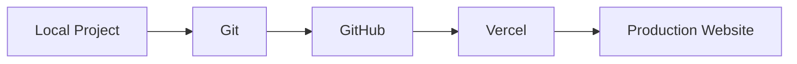
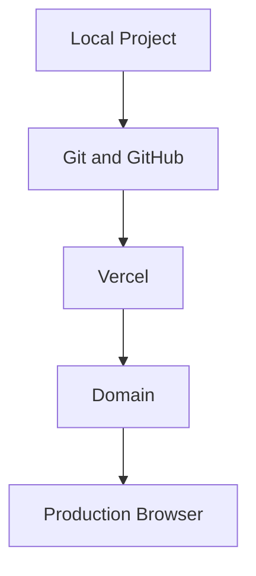

# About This Guide

This documentation project was created to explain the process of publishing a React and Vite website with GitHub and Vercel.

The goal was not only to document the individual tools, but to show how they work together as part of a complete deployment workflow.

## Audience

The primary audience is beginning React developers who:

- have a working React and Vite project
- have basic experience using a terminal
- may have little or no experience with Git
- have not deployed a website before
- want to understand the deployment process rather than simply copy commands

The guide assumes familiarity with basic file navigation and React development, but does not assume prior knowledge of hosting, DNS, GitHub repositories, or Vercel.

## Documentation Goals

The guide was designed around four main goals.

### Explain the Complete Workflow

A beginner may understand React but still be unfamiliar with how local development, Git, GitHub, and hosting relate to one another.

The documentation presents deployment as a connected workflow:



Each section introduces one part of this process before connecting it to the next.

### Separate Tasks from Reference Information

The main pages focus on procedures such as:

- preparing a project
- configuring Git
- publishing to GitHub
- deploying with Vercel
- updating a website

Reference information is kept separate when possible.

For example, the [Git Quick Reference](git-reference.md) provides a compact list of commands without requiring readers to search through the longer procedures.

### Include Verification

The guide does not assume that a task succeeded simply because a command completed.

Major procedures include verification steps.

Examples include:

- testing the Vite production build
- checking Git status before committing
- confirming files appear on GitHub
- reviewing the Vercel deployment
- testing the production website
- checking direct routes after deployment

This helps readers identify problems closer to the point where they occur.

### Support Troubleshooting

Deployment involves several systems, which can make failures difficult for beginners to diagnose.

The troubleshooting documentation follows a layered approach:



Readers are encouraged to determine where the failure occurs before changing configuration.

## Information Architecture

The documentation is organized around the user's workflow rather than around individual technologies.

The main structure is:

```text
Prepare
├── Before You Begin
└── Verify Your Project

Publish
├── Set Up Git
├── Publish to GitHub
└── Deploy with Vercel

Verify
└── Verify the Deployment

Maintain
├── Update Your Website
└── Add a Custom Domain

Support
├── Troubleshooting
└── Git Quick Reference
```

This structure allows a first-time user to read the guide sequentially while allowing returning users to jump directly to a specific task or reference page.

## Writing Approach

The documentation uses several conventions throughout the guide.

### Commands Are Introduced in Context

Commands are shown when the reader needs them.

For example:

```bash
git status
```

is introduced as a way to inspect the repository before the reader is asked to stage or commit changes.

### Procedures Use Direct Instructions

Procedures use short steps and action-oriented language.

For example:

1. Open the project.
2. Run the build.
3. Review the output.
4. Correct any errors before continuing.

### Expected Results Are Included

Where useful, the guide shows what the reader should expect after performing an action.

Example:

```text
nothing to commit, working tree clean
```

This gives readers a way to determine whether they completed the step correctly.

### Diagrams Explain Relationships

Mermaid diagrams are used for processes that are easier to understand visually.

Examples include:

- Git staging and commits
- GitHub and Vercel deployment
- DNS routing
- update workflows
- troubleshooting decisions

The diagrams supplement the written instructions rather than replacing them.

## Tools Used

The documentation was created with:

- Markdown
- MkDocs
- Material for MkDocs
- Mermaid
- Git
- GitHub

The guide itself documents:

- React
- Vite
- Git
- GitHub
- Vercel
- DNS concepts

## Documentation Types

This project includes several forms of technical documentation:

- getting-started content
- procedural instructions
- conceptual explanations
- troubleshooting documentation
- reference documentation
- workflow diagrams
- checklists

Using several document types allows the guide to support both first-time readers and users returning to solve a specific problem.

## Scope

The guide focuses on deploying a standard React and Vite website.

It does not attempt to cover every possible:

- React framework
- hosting provider
- Git workflow
- DNS provider
- backend architecture
- CI/CD configuration

Limiting the scope keeps the documentation focused on the needs of its intended audience.

## Project Outcome

The finished project provides a complete path from a local React project to a publicly deployed website.

It also demonstrates documentation practices including:

- audience analysis
- information architecture
- task-oriented writing
- reference writing
- troubleshooting
- visual communication
- documentation as code
