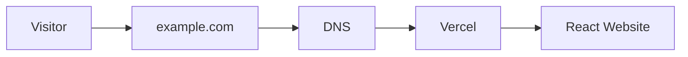
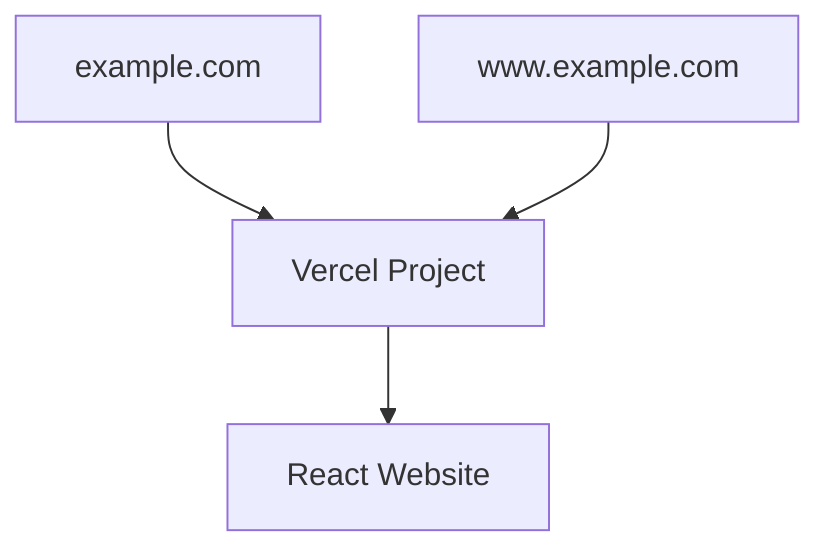
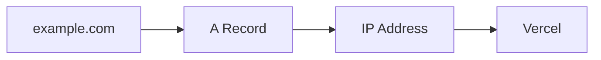
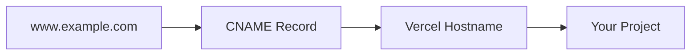
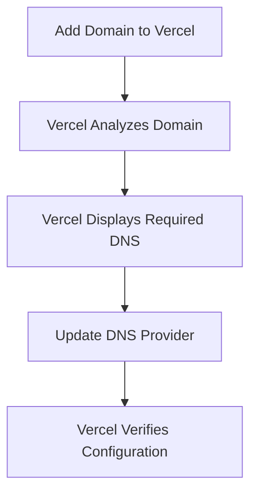
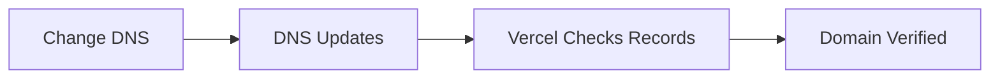
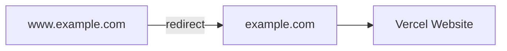
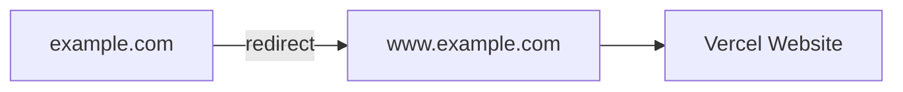
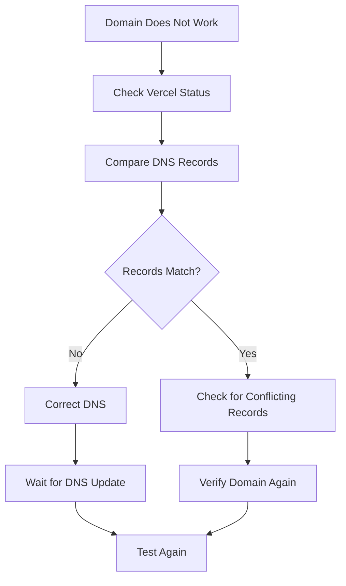
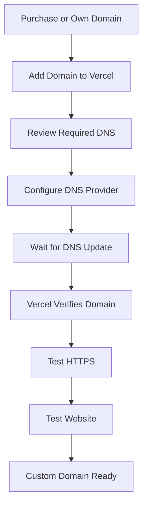

# Add a Custom Domain

Every Vercel deployment receives a default address similar to:

```text
https://your-project.vercel.app
```

You can continue using this address or connect a custom domain such as:

```text
https://example.com
```

A custom domain is optional. Your website will continue working with its Vercel address if you do not add one.

## How a Custom Domain Works

A domain name gives visitors an easier address to remember.

The domain does not contain the website itself. DNS directs visitors from the domain name to the service hosting the website.



DNS stands for **Domain Name System**.

It connects human-readable domain names with the services that handle requests for those domains.

## Root Domains and Subdomains

A root domain looks like:

```text
example.com
```

A subdomain adds another name before the root domain.

Examples include:

```text
www.example.com
```

and:

```text
docs.example.com
```

A website may use both a root domain and one or more subdomains.

For example:



The DNS configuration can differ depending on whether you are connecting a root domain or a subdomain.

## Open the Domain Settings

In Vercel:

1. Open your project.
2. Open the project's domain settings.
3. Choose the option to add a domain.
4. Enter the domain you want to connect.

For example:

```text
example.com
```

Vercel will analyze the domain and display the configuration required to connect it.

## Add an Existing Domain

If you already own a domain, enter it into Vercel.

Select the environment that should use the domain.

For the main public website, this will normally be:

```text
Production
```

After adding the domain, Vercel checks whether its DNS configuration points to the project correctly.

## Configure DNS

If the domain is managed by another provider, you may need to update its DNS records.

Vercel displays the required record type and value for your specific domain.

A DNS record normally contains information such as:

```text
Type
Name
Value
TTL
```

The exact labels may vary depending on your DNS provider.

Use the values shown by Vercel rather than copying DNS settings from another project or tutorial.

## A Records

An **A record** connects a domain name to an IP address.

A root domain may use an A record.

Conceptually:



If Vercel asks you to create an A record, copy the value displayed in your project's domain settings.

Do not guess the IP address.

## CNAME Records

A **CNAME record** creates an alias from one hostname to another.

Subdomains commonly use CNAME records.

For example:

```text
www.example.com
```

may use a structure similar to:

```text
Type: CNAME
Name: www
Value: Vercel-provided target
```

Conceptually:



Use the exact CNAME destination shown by Vercel.

## Why You Should Use Vercel's Values

DNS configuration can depend on:

- the project
- the domain
- whether the domain is a root domain
- whether it is a subdomain
- where the DNS is managed

Because of these differences, avoid hard-coding DNS values from another setup.

Instead:



This makes the procedure more reliable and less likely to become outdated.

## Update DNS at Your Provider

If your domain is registered or managed outside Vercel:

1. Open your domain provider.
2. Find the DNS management page.
3. Locate the DNS records.
4. Add or modify the record Vercel requests.
5. Save the change.

Common domain providers include registrars and dedicated DNS services.

The interface will vary by provider, but the underlying record normally includes:

```text
Record Type
Host or Name
Value or Target
TTL
```

Copy the values carefully.

## Automated DNS Configuration

Some domain providers support automated DNS configuration.

If Vercel detects that your provider supports this feature, you may be offered an automated setup option.

Follow the instructions shown in Vercel.

If automated configuration is not available, configure the DNS records manually.

## Wait for DNS Changes

DNS updates are not always visible immediately.

After changing the records, return to Vercel and check the domain status.

The process is:



Do not repeatedly change records while waiting unless Vercel reports that the configuration is incorrect.

Changing several records at once can make troubleshooting more difficult.

## Verify the Domain

Once Vercel reports that the domain is configured correctly, open it in your browser.

For example:

```text
https://example.com
```

Verify that:

- the website loads
- navigation works
- images appear
- interactive features work
- direct routes work
- the site behaves the same as the Vercel URL

## HTTPS

A production website should use HTTPS.

You can recognize HTTPS at the beginning of the address:

```text
https://example.com
```

HTTPS encrypts traffic between the visitor's browser and the website.

Once a domain is connected correctly, Vercel manages HTTPS certificates for the deployed project.

You normally do not need to purchase a separate certificate for the Vercel deployment.

## Root Domain vs. `www`

A website may be accessible through both:

```text
example.com
```

and:

```text
www.example.com
```

It is usually better to choose one version as the primary address.

For example:



or:



Either approach can work.

The important part is that visitors consistently arrive at the intended version.

## Test Direct Routes

If the website uses React Router, do not test only the homepage.

Open a nested route directly.

For example:

```text
https://example.com/projects/example
```

Then refresh the browser.

Verify that the page still loads.

If the homepage works but direct routes return a `404`, the problem is probably related to application routing rather than the domain itself.

## If Vercel Reports Invalid Configuration

If Vercel reports that the domain is not configured correctly, compare the DNS records at your provider with the values Vercel displays.

Check for:

- incorrect record type
- incorrect hostname
- incorrect destination
- spelling mistakes
- duplicate records
- conflicting records
- records left over from a previous hosting provider

Do not immediately delete unrelated DNS records.

Some records may be used for services such as email.

## Troubleshooting the Domain

Use a controlled troubleshooting process:



Change one thing at a time whenever possible.

This makes it easier to determine which change solved the problem.

## Default Vercel URL Still Works

Connecting a custom domain does not normally remove the project's original Vercel address.

You may still have an address similar to:

```text
https://your-project.vercel.app
```

along with:

```text
https://example.com
```

The custom domain becomes the address you normally share with users.

## Domain Setup Checklist

Before considering the custom domain complete, verify:

- [ ] the domain was added to the correct Vercel project
- [ ] the correct environment is selected
- [ ] DNS records match the values shown by Vercel
- [ ] Vercel reports the domain as configured
- [ ] the custom domain opens in a browser
- [ ] HTTPS works
- [ ] the homepage works
- [ ] navigation works
- [ ] images load
- [ ] direct routes work
- [ ] the preferred domain version is clear
- [ ] alternate domain versions redirect appropriately if configured

## Domain Workflow Summary

The complete process is:



## Next Step

Once the domain is working correctly, continue to [Troubleshooting](troubleshooting.md) for common deployment, Git, routing, asset, and domain problems.
