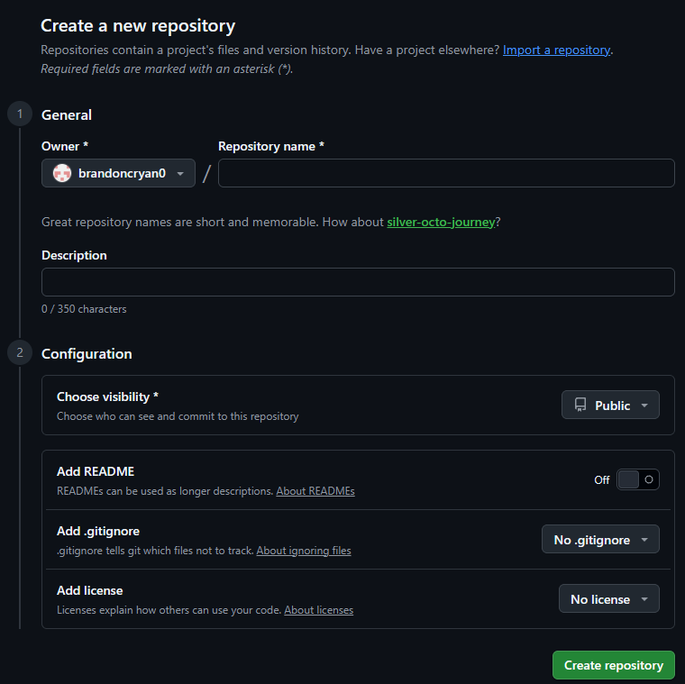
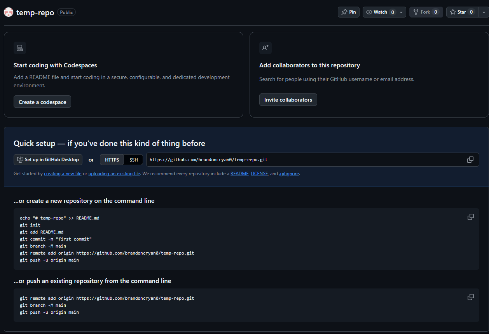
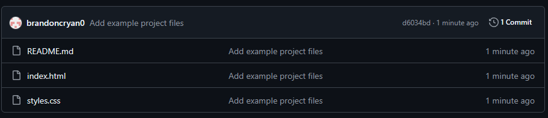
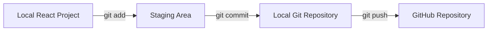

# Publish to GitHub

GitHub stores a copy of your Git repository online. Once your project is on GitHub, you can connect it to Vercel for deployment.

## Create a New GitHub Repository

Create a new repository on GitHub for your React project.

{ .doc-screenshot }

<p class="doc-caption">
GitHub's repository creation screen. Enter a repository name, choose its visibility, and leave the initialization options disabled when publishing an existing local project.
</p>

1. Sign in to GitHub.
2. Select **New repository**.
3. Enter a repository name.
4. Choose whether the repository should be public or private.
5. Leave the repository empty for now.
6. Select **Create repository**.

!!! note "Publishing an existing project"

    If your local project already contains a README or `.gitignore`, leave those options disabled when creating the GitHub repository.

## Copy the Repository URL

After creating the repository, GitHub displays setup instructions and the repository URL.

{ .doc-screenshot }

<p class="doc-caption">
After creating an empty repository, GitHub provides the repository URL and commands for connecting an existing local project.
</p>

The repository URL will look similar to:

```text
https://github.com/USERNAME/REPOSITORY.git
```

Copy this URL.

## Connect the Local Project to GitHub

Return to PowerShell inside your React project folder.

Run:

```bash
git remote add origin https://github.com/USERNAME/REPOSITORY.git
```

Replace the example URL with the URL for your repository.

This command creates a remote connection named:

```text
origin
```

`origin` is the conventional name for the main remote repository.

## Verify the Remote

Run:

```bash
git remote -v
```

You should see output similar to:

```text
origin  https://github.com/USERNAME/REPOSITORY.git (fetch)
origin  https://github.com/USERNAME/REPOSITORY.git (push)
```

This confirms that your local Git repository is connected to GitHub.

## Rename the Main Branch

Run:

```bash
git branch -M main
```

This names the primary branch:

```text
main
```

GitHub commonly uses `main` as the default branch name.

## Push the Project to GitHub

Run:

```bash
git push -u origin main
```

This sends the commits from your local repository to GitHub.

The `-u` option connects your local `main` branch to the remote `main` branch.

After this first push, you can usually publish future commits with:

```bash
git push
```

## Verify the Repository

Return to GitHub and refresh the repository page.

{ .doc-screenshot }

<p class="doc-caption">
After the first push, the repository page displays the uploaded project files and the most recent commit.
</p>

You should now see your project files, such as:

```text
src/
public/
package.json
vite.config.js
```

Do not expect to see ignored files such as:

```text
node_modules/
```

If your `.gitignore` is configured correctly, those files will remain on your computer without being uploaded to GitHub.

## Understand the Workflow

At this point, the project exists both locally and on GitHub.



The local project is where you make changes.

Git records those changes on your computer.

GitHub stores the committed version online.

Later, Vercel will connect to the GitHub repository and use it to build the public website.

## If `git push` Fails

### Authentication Error

GitHub may require you to sign in through your browser or authenticate using a supported credential method.

Follow the authentication prompt and try the push again.

### Remote Already Exists

If Git displays:

```text
error: remote origin already exists
```

check the existing remote:

```bash
git remote -v
```

If the URL is correct, you do not need to add it again.

If the URL is incorrect, update it with:

```bash
git remote set-url origin https://github.com/USERNAME/REPOSITORY.git
```

Then verify the change:

```bash
git remote -v
```

### Wrong Branch

Check your current branch:

```bash
git branch
```

The active branch is marked with an asterisk.

For example:

```text
* main
```

If necessary, rename the branch:

```bash
git branch -M main
```

Then try the push again:

```bash
git push -u origin main
```

## GitHub Checklist

Before continuing, verify that:

- [ ] the GitHub repository exists
- [ ] the local project is connected to the correct remote
- [ ] the active branch is `main`
- [ ] the first push completed successfully
- [ ] project files appear on GitHub
- [ ] ignored files such as `node_modules` were not uploaded
- [ ] the latest commit appears in the repository

## Next Step

Once the repository is visible on GitHub, continue to [Deploy with Vercel](vercel.md).
