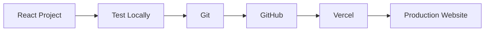
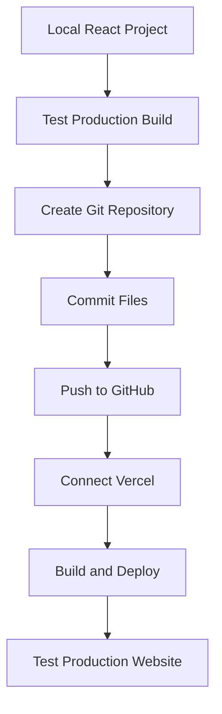
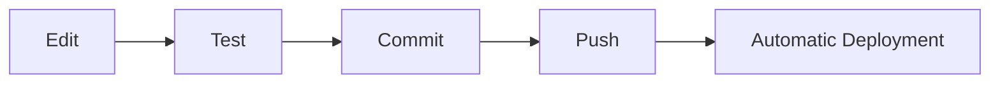

# Deploying a React Website

A beginner-friendly guide to publishing a React and Vite website with GitHub and Vercel.

This guide walks through the full deployment process, from checking a local project to publishing it online and maintaining it after launch.

## What This Guide Covers

You will learn how to:

- verify that a React project is ready for deployment
- set up Git version control
- publish a project to GitHub
- deploy the project with Vercel
- test the production website
- publish future updates
- connect a custom domain
- troubleshoot common deployment problems

## Deployment Workflow

The complete workflow is:



Each part of the guide focuses on one stage of this process.

## Who This Guide Is For

This guide is intended for beginning React developers who:

- have a working React project created with Vite
- are comfortable opening a terminal
- have little or no experience deploying websites
- want to understand what happens between local development and production

You do not need previous experience with GitHub, Vercel, DNS, or website hosting.

## What You Need

Before starting, you will need:

- Node.js and npm
- Git
- a GitHub account
- a Vercel account
- a working React and Vite project
- a code editor such as Visual Studio Code

See [Before You Begin](prerequisites.md) for setup details.

## How the Guide Is Organized

### Prepare

Start by checking your tools and confirming that the project builds correctly.

- [Before You Begin](prerequisites.md)
- [Verify Your Project](local-build.md)

### Publish

Place the project under version control and publish it online.

- [Set Up Git](git-setup.md)
- [Publish to GitHub](github.md)
- [Deploy with Vercel](vercel.md)

### Verify

Test the live website after deployment.

- [Verify the Deployment](verify-deployment.md)

### Maintain

Learn how to publish future updates and connect a custom domain.

- [Update Your Website](updating-site.md)
- [Add a Custom Domain](custom-domain.md)

### Support

Use the support pages when something goes wrong or when you need to remember a command.

- [Troubleshooting](troubleshooting.md)
- [Git Quick Reference](git-reference.md)

## Initial Deployment

The first deployment involves several connected tools:



After this initial setup, future updates require fewer steps.

## Updating the Website

Once GitHub and Vercel are connected:



This workflow allows GitHub to remain the source of truth for the project while Vercel handles production deployment.

## About the Examples

Commands in this guide are written primarily for PowerShell on Windows.

For example:

```bash
npm run build
git status
git add .
git commit -m "Update website"
git push
```

Most Git and npm commands also work in other terminals, although navigation and file-management commands may differ.

Example usernames, repository names, domains, and URLs are placeholders.

Replace values such as:

```text
USERNAME
REPOSITORY
example.com
```

with your own information when following the guide.

## Start Here

Begin with [Before You Begin](prerequisites.md) to confirm that your computer has the required tools.
