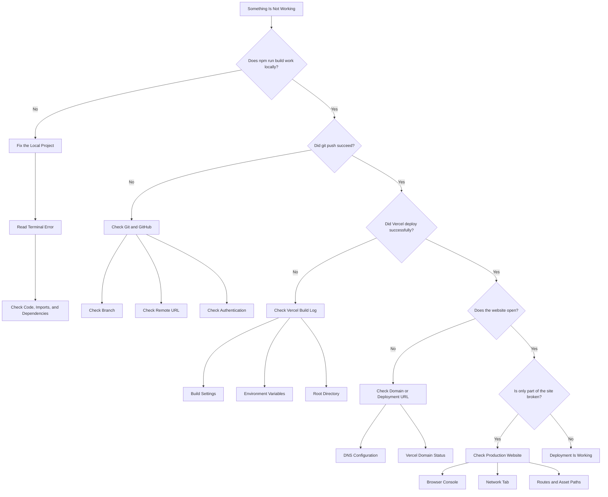

# Troubleshooting

This section covers common problems that can occur when publishing a React and Vite website with GitHub and Vercel.

Start with the symptom that most closely matches what you are seeing.

## Where Should You Start?

Use this flowchart to narrow down the source of the problem.



The main troubleshooting rule is:

> **Start locally, then move outward.**

If the project does not work on your computer, fix the application first. If it works locally but fails later in the workflow, investigate GitHub, Vercel, or the production environment.

## The Project Does Not Build Locally

### Symptoms

Running:

```bash
npm run build
```

returns an error.

### Possible Causes

- syntax error
- missing dependency
- incorrect import path
- invalid configuration
- unresolved file reference

### Resolution

Read the terminal output carefully.

The error usually identifies the file and line associated with the problem.

Fix the local build before attempting to deploy the website.

Do not rely on Vercel to fix a project that does not build locally.

---

## The Project Works Locally but Fails on Vercel

### Symptoms

The development server works, but Vercel reports a failed deployment.

### Possible Causes

- missing environment variables
- incorrect build settings
- incorrect root directory
- case-sensitive file paths
- dependency mismatch

### Resolution

First confirm that the production build still succeeds locally:

```bash
npm run build
```

Then review the Vercel build log.

Check:

- Framework Preset
- Build Command
- Output Directory
- Root Directory
- Environment Variables

A standard Vite project commonly uses:

```text
Framework Preset: Vite
Build Command: npm run build
Output Directory: dist
```

---

## Images Do Not Appear in Production

### Symptoms

Images work locally but appear broken after deployment.

### Possible Causes

- incorrect file path
- capitalization mismatch
- asset stored in the wrong folder
- outdated reference after moving a file

### Resolution

Check the exact filename.

For example:

```text
ProjectImage.png
```

and:

```text
projectimage.png
```

may be treated as different files in production.

Also confirm that the image path matches the actual project structure.

For files in Vite's `public` folder, paths normally begin from the site root.

Example:

```text
public/images/logo.png
```

can be referenced as:

```text
/images/logo.png
```

---

## A Page Returns 404 After Refreshing

### Symptoms

Navigation to a React route works normally, but refreshing the page returns:

```text
404
```

### Possible Cause

The application uses client-side routing.

The browser requests the route directly from the hosting service, but the hosting service does not know that React should handle the route.

### Resolution

Confirm that the application uses React Router or another client-side router.

Then configure the hosting service so application routes fall back to:

```text
index.html
```

After changing the routing configuration:

1. commit the change
2. push it to GitHub
3. wait for Vercel to redeploy
4. open the nested route directly
5. refresh the page

---

## Recent Changes Do Not Appear Online

### Symptoms

You changed the project locally, but the public site still shows the old version.

### Possible Causes

- changes were not committed
- commit was not pushed
- Vercel has not finished deploying
- browser cache is showing an older version

### Resolution

Run:

```bash
git status
```

Then:

```bash
git log -1
```

Confirm that your latest change was committed.

Then check the GitHub repository.

If GitHub has the latest commit, check Vercel's deployment history.

After the deployment succeeds, refresh the production website.

If necessary, try a private browsing window.

---

## `git push` Fails

### Symptoms

Running:

```bash
git push
```

returns an error.

### Check the Remote

Run:

```bash
git remote -v
```

Confirm that the repository URL is correct.

### Check the Branch

Run:

```bash
git branch
```

The active branch is marked with:

```text
*
```

If the intended branch is `main`, you should see:

```text
* main
```

### Check Authentication

GitHub may require you to authenticate through your browser or credential manager.

Follow the authentication prompt and retry the command.

---

## `remote origin already exists`

### Symptoms

Running:

```bash
git remote add origin <repository-url>
```

returns:

```text
error: remote origin already exists
```

### Resolution

Check the existing remote:

```bash
git remote -v
```

If the remote URL is correct, you do not need to add it again.

If the URL is wrong, update it:

```bash
git remote set-url origin <repository-url>
```

Then verify:

```bash
git remote -v
```

---

## Vercel Cannot Find the GitHub Repository

### Symptoms

The repository does not appear when creating a Vercel project.

### Possible Causes

- Vercel does not have permission to access the repository
- the wrong GitHub account is connected
- repository permissions are restricted

### Resolution

Check the GitHub account connected to Vercel.

Then review the GitHub permissions granted to the Vercel integration.

Make sure Vercel is allowed to access the repository you want to deploy.

---

## Environment Variables Are Missing

### Symptoms

The project builds, but a feature that depends on an external service does not work.

The browser console may show failed requests or configuration errors.

### Possible Cause

A required environment variable exists locally but has not been configured in Vercel.

### Resolution

Identify which environment variables the project requires.

Add them to the project's environment-variable settings in Vercel.

Do not publish private credentials directly in your source code or commit a private `.env` file to a public repository.

After adding or changing environment variables, redeploy the project.

---

## The Custom Domain Does Not Work

### Symptoms

The default Vercel address works, but the custom domain does not.

### Possible Causes

- incorrect DNS record
- DNS change has not propagated
- domain was added to the wrong project
- conflicting DNS records exist

### Resolution

Open the project's domain settings in Vercel.

Compare the DNS records at your domain provider with the records Vercel expects.

Check for:

- incorrect record type
- incorrect host
- incorrect value
- old conflicting records

After making a correction, wait for Vercel to verify the domain again.

---

## The Website Looks Different in Production

### Symptoms

The production website loads, but styles, images, or layout differ from the local version.

### Possible Causes

- missing assets
- cached files
- environment differences
- incorrect paths
- unsupported browser behavior

### Resolution

Compare the production site with the local production preview:

```bash
npm run build
npm run preview
```

Then check the browser console and Network tab on the production website.

Look for:

- failed requests
- missing stylesheets
- missing images
- JavaScript errors

---

## The Browser Console Shows a 404

### Meaning

A `404` means that the browser requested a resource that could not be found.

### Common Examples

- missing image
- incorrect JavaScript file
- incorrect route
- broken download link

### Resolution

Open the failed request in the browser's Network tab.

Check the requested path and compare it with the file or route that should exist.

---

## The Browser Console Shows a 500 Error

### Meaning

A `500` error generally indicates that something failed while processing the request.

For a static Vite site, this may involve:

- serverless functions
- external APIs
- hosting configuration

### Resolution

Check:

- Vercel logs
- function logs if applicable
- external service status
- environment variables

A `500` error is different from a missing file and usually requires investigation beyond correcting a simple asset path.

---

## Troubleshooting Process

When you are unsure what caused a problem, use a consistent process:

```text
Identify the symptom
        ↓
Reproduce the problem
        ↓
Check the browser or terminal error
        ↓
Determine whether the problem is local or production-only
        ↓
Change one thing
        ↓
Test again
        ↓
Document the result
```

Avoid changing several settings at the same time.

If multiple things change at once, it becomes harder to identify which change actually solved the problem.

## Start Local

A useful troubleshooting rule is:

```text
Does it work locally?
```

If the answer is no, fix the local project first.

If the answer is yes but production fails, investigate the deployment environment.

This helps narrow the problem:

```text
Fails locally
     ↓
Application problem

Works locally
but fails online
     ↓
Deployment or environment problem
```

## Troubleshooting Checklist

When a deployment problem occurs, check:

- [ ] `npm run build` succeeds locally
- [ ] `git status` shows expected changes
- [ ] latest commit exists
- [ ] latest commit appears on GitHub
- [ ] Vercel received the commit
- [ ] Vercel build completed successfully
- [ ] required environment variables exist
- [ ] image and file paths use correct capitalization
- [ ] browser console contains no unexpected errors
- [ ] Network tab contains no unexplained failed requests
- [ ] custom domain DNS matches Vercel's instructions

## Next Step

Once you are familiar with the common problems and how to diagnose them, continue to [Git Quick Reference](git-reference.md).
