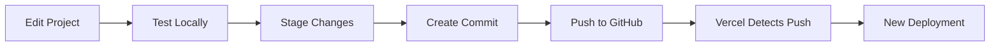
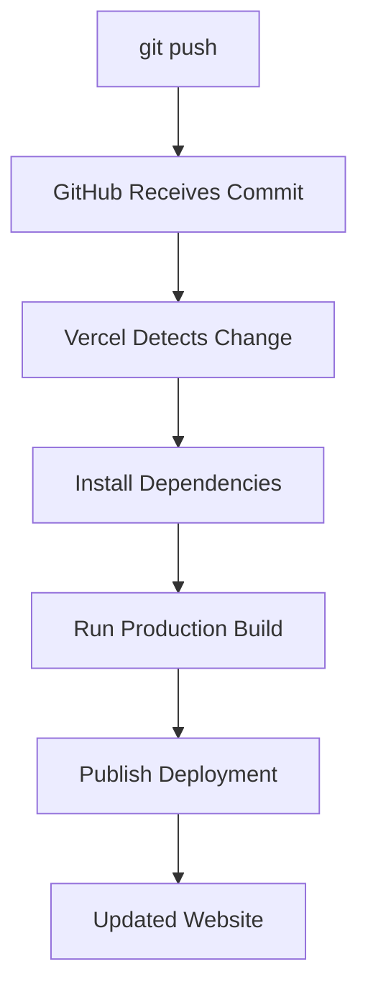
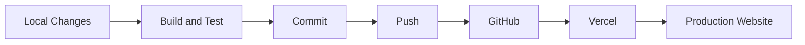
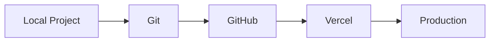
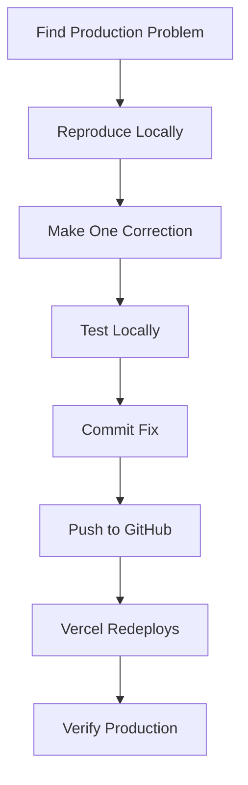

# Update Your Website

After the initial deployment, you do not need to repeat the full setup process every time you make a change.

Once GitHub and Vercel are connected, future updates can follow a shorter workflow.

## Update Workflow

The normal process is:



Vercel monitors the connected GitHub repository. When a new commit is pushed, Vercel can automatically build and publish the updated version.

## Make Your Changes

Open your React project and edit the files you want to update.

Examples include:

- changing text
- adding a page
- updating an image
- fixing a bug
- changing styles
- adding a new feature

Save your files when you are finished.

## Test the Changes Locally

Before publishing the update, start the development server:

```bash
npm run dev
```

Open the local website in your browser.

Verify that:

- the new content appears
- navigation still works
- existing features still work
- there are no unexpected layout problems
- the browser console does not show major errors

Do not publish changes simply because the files saved successfully.

## Test the Production Build

Run:

```bash
npm run build
```

The build should complete without errors.

You can also preview the production build:

```bash
npm run preview
```

Testing the production build before committing can reveal problems that do not appear during development.

## Check Git Status

Run:

```bash
git status
```

Git shows which files have changed.

Example:

```text
modified:   src/App.jsx
modified:   src/App.css
```

Review this list before staging the changes.

Make sure you recognize the files that will be included in the update.

## Stage the Changes

To stage all changed files, run:

```bash
git add .
```

Then check the repository again:

```bash
git status
```

The staged files should appear under:

```text
Changes to be committed
```

## Create a Commit

Create a commit that describes the change:

```bash
git commit -m "Update homepage content"
```

Use a short and specific message.

Good examples include:

```text
Fix mobile navigation
```

```text
Add contact page
```

```text
Update project screenshots
```

```text
Correct broken resume link
```

Avoid vague messages such as:

```text
changes
```

or:

```text
update stuff
```

Clear commit messages make the project history easier to understand.

## Push the Commit

Run:

```bash
git push
```

Git sends the new commit to the connected GitHub repository.

Because the repository was already connected during the initial setup, you normally do not need to provide the repository URL again.

## Verify the Push

Open the repository on GitHub.

The newest commit should appear near the top of the repository page.

Confirm that:

- the new commit appears
- the commit message is correct
- the expected files were updated

## Automatic Deployment

After GitHub receives the commit, Vercel detects the change and starts another deployment.



You can monitor the deployment from the Vercel dashboard.

## Check the Deployment Result

The deployment will eventually report a status such as:

```text
Ready
```

or:

```text
Failed
```

If the deployment succeeds, the production website has been updated.

If it fails, open the deployment and review the build logs.

## Verify the Production Website

A successful deployment does not guarantee that the change works correctly.

Open the public website and test the specific content or feature that you changed.

For example, if you updated an image:

1. Open the page containing the image.
2. Confirm that the new image appears.
3. Check the page at a mobile width.
4. Confirm that the change did not cause layout problems.

## Refresh Cached Content

Sometimes a browser may display an older version of a file.

If a recent change does not appear, try:

- refreshing the page
- performing a hard refresh
- opening the site in a private window
- checking the latest Vercel deployment

Before editing the project again, confirm that the newest deployment actually completed.

## Typical Update Commands

For a small website update, the terminal workflow may be:

```bash
npm run build
git status
git add .
git commit -m "Update homepage content"
git push
```

The complete process looks like:



## Keep GitHub as the Source of Truth

Changes should normally begin in your local project and move through Git and GitHub before reaching production.



This makes the repository the reliable record of the current project.

Avoid maintaining separate versions of the project in multiple locations.

## If an Update Breaks the Website

If you discover a problem after deployment:

1. Identify the problem on the production website.
2. Reproduce the problem locally if possible.
3. Correct the problem locally.
4. Test the correction.
5. Create a new commit.
6. Push the correction.
7. Verify the new deployment.

The troubleshooting process should remain controlled:



Avoid making several unrelated changes while diagnosing one problem.

Small changes make it easier to determine what actually fixed the issue.

## Update Checklist

Before considering an update complete, verify:

- [ ] changes work locally
- [ ] `npm run build` succeeds
- [ ] only intended files changed
- [ ] commit message describes the update
- [ ] commit appears on GitHub
- [ ] Vercel deployment succeeds
- [ ] production website shows the update
- [ ] affected pages still work on mobile
- [ ] no new major browser errors appear

## Next Step

Once you understand how updates move from your local project to production, continue to [Add a Custom Domain](custom-domain.md).
