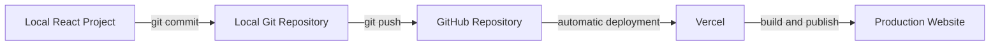
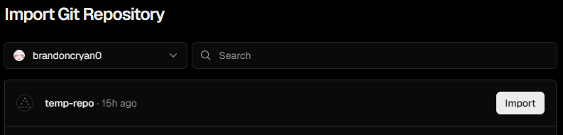
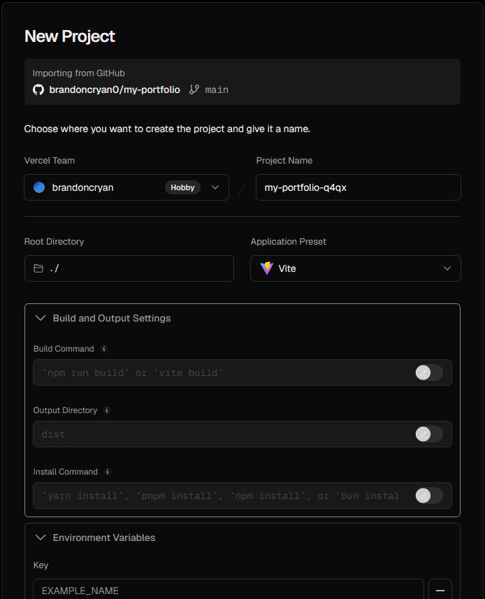
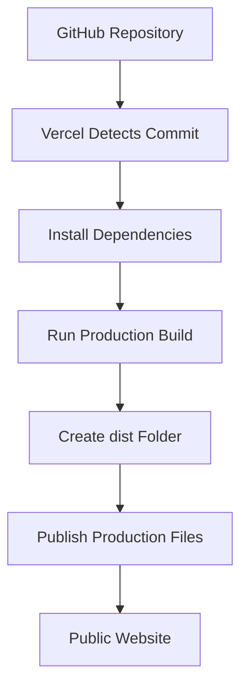
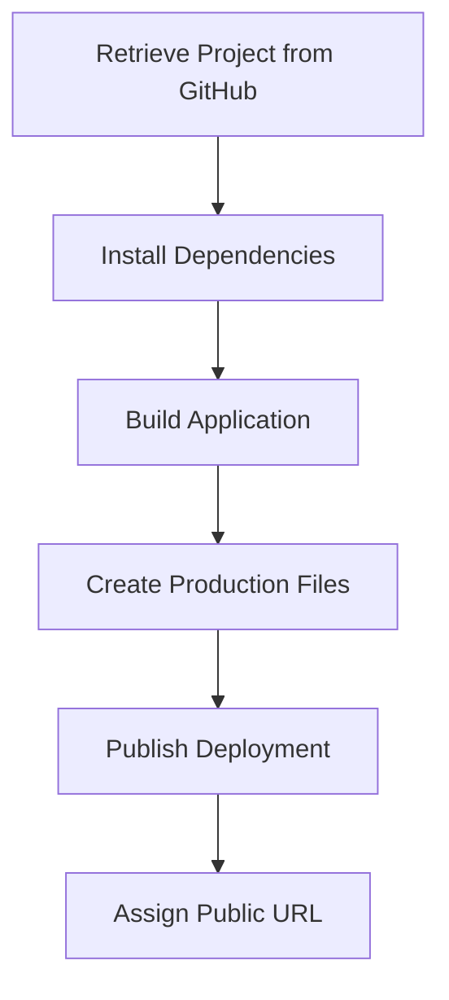
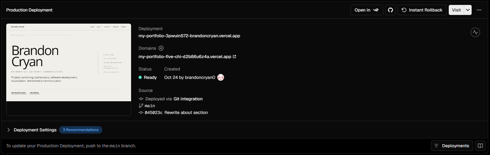
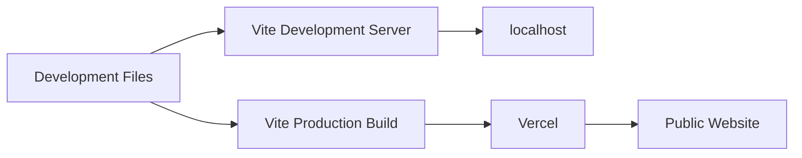
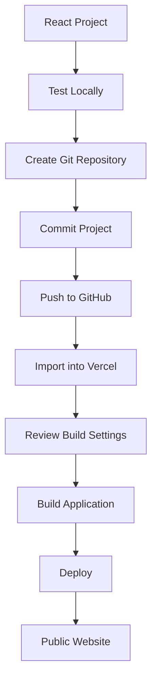

# Deploy with Vercel

Now that your React project is stored on GitHub, you can deploy it with Vercel.

Vercel connects to your GitHub repository, builds the application, and publishes the finished website online.

## How the Deployment Works

At this point, your project moves through four main locations:



Your computer contains the working project. Git records your changes, GitHub stores the repository online, and Vercel builds and publishes the website.

After the initial setup, pushing a new commit to GitHub can automatically trigger another Vercel deployment.

## Sign In to Vercel

Open Vercel in your browser and sign in.

If possible, use the GitHub account that contains your React repository. This makes it easier to give Vercel access to the project.

## Create a New Project

From the Vercel dashboard, create a new project from your GitHub repository.

{ .doc-screenshot }

<p class="doc-caption">
Vercel lists GitHub repositories that are available to import as new deployment projects.
</p>

1. Select **Create New**.
2. Select **Project**.
3. Connect GitHub if prompted.
4. Find the repository containing your React project.
5. Select **Import**.

If the repository does not appear, Vercel may not have permission to access it.

Review your GitHub integration permissions before continuing.

## Review the Project Settings

After selecting **Import**, Vercel displays the configuration it will use to build the project.

{ .doc-screenshot }

<p class="doc-caption">
Vercel detects the Vite project and provides the build configuration before deployment.
</p>

For a standard React project created with Vite, the settings will usually resemble:

```text
Application Preset: Vite
Build Command: npm run build
Output Directory: dist
Root Directory: ./
```

Vercel normally detects these values automatically.

Do not change them unless your project requires a different configuration.

## Application Preset

Confirm that Vercel identifies the application as:

```text
Vite
```

The application preset tells Vercel how the project should be built.

If Vercel correctly detects Vite, you normally do not need to configure the build process manually.

## Build Command

A standard Vite application uses:

```bash
npm run build
```

Vercel may also display the underlying Vite command:

```bash
vite build
```

The build command creates the production version of the application.

You tested this process earlier in the guide before uploading the project to GitHub.

If the project does not build locally, resolve the error before deploying.

!!! tip "Test before deploying"

    Run `npm run build` locally before deploying. If the production build fails on your computer, it will usually fail on Vercel as well.

## Output Directory

A standard Vite build creates a folder named:

```text
dist
```

This folder contains the optimized production files that Vercel publishes.

The build process looks like this:



The files inside `src` are development source files. Vercel does not simply upload those files unchanged.

Instead, Vite processes the project and creates the production files inside `dist`.

## Root Directory

For most Vite projects, leave the Root Directory as:

```text
./
```

This means the application is located at the root of the repository.

You only need to change this setting if the React application is stored inside another folder.

For example:

```text
repository/
├── README.md
└── website/
    ├── package.json
    ├── src/
    ├── public/
    └── vite.config.js
```

In this example, the Root Directory should point to:

```text
website
```

If `package.json` is located directly in the repository root, you normally do not need to change this setting.

## Install Command

Vercel normally detects the package manager used by the project.

For an npm project, the installation process commonly uses:

```bash
npm install
```

This installs the dependencies listed in:

```text
package.json
```

and, when present:

```text
package-lock.json
```

For a standard Vite project, you normally do not need to override the Install Command.

## Environment Variables

Some applications require environment variables.

Environment variables store configuration values that may differ between development and production.

Examples include:

- API URLs
- API keys
- service configuration
- application settings

If your application requires environment variables, add them before deployment.

!!! warning "Keep credentials private"

    Never commit API keys, passwords, tokens, or private `.env` files to a public GitHub repository.

Do not place private credentials directly in your source code.

You should also avoid committing private `.env` files to a public GitHub repository.

If your project does not use environment variables, you can skip this step.

## Deploy the Project

After reviewing the settings, select:

**Deploy**

Vercel begins building the project.

The process generally follows this sequence:



You can monitor the deployment progress from the Vercel dashboard.

## Watch the Build Log

While the deployment is running, Vercel displays information about the build.

You may see messages similar to:

```text
Installing dependencies...
Building...
Deploying...
```

The build log is especially useful when a deployment fails.

Instead of immediately changing project settings, read the error shown in the log.

The message may identify:

- a missing dependency
- a syntax error
- an incorrect file path
- a failed build command
- a missing environment variable

## Successful Deployment

When the deployment finishes successfully, Vercel marks it as ready and provides a public URL.

{ .doc-screenshot }

<p class="doc-caption">
A successful production deployment displays a Ready status, the source commit, and the public website address.
</p>

The address usually looks similar to:

```text
https://your-project.vercel.app
```

Open the URL in a new browser tab.

Your React website is now publicly accessible.

## Local Development vs. Production

During development, Vite may give you an address such as:

```text
http://localhost:5173/
```

This address only works on your computer while the development server is running.

The Vercel address is different:

```text
https://your-project.vercel.app
```

This is the production website that other people can visit.

The two environments can be represented as:



Because development and production are different environments, a website that works locally should still be tested after deployment.

## Do Not Stop at the Success Screen

A successful Vercel deployment means the project built and was published.

It does not guarantee that every part of the website works correctly.

A successful deployment can still contain:

- broken images
- incorrect links
- missing environment variables
- broken page routes
- layout problems
- browser errors

Always test the production website after deployment.

## Initial Deployment Workflow

You have now completed the initial publishing workflow:



After the initial deployment, you do not need to repeat all of these steps for every update.

Later changes can follow a shorter Git-based workflow.

## If the Deployment Fails

First determine whether the problem also occurs locally.

Run:

```bash
npm run build
```

### If the Local Build Fails

Fix the local build error first.

A project that cannot create a production build locally will usually fail when Vercel attempts the same process.

### If the Local Build Succeeds

If the project builds locally but fails on Vercel, review:

- Vercel build logs
- Application Preset
- Build Command
- Output Directory
- Root Directory
- Install Command
- environment variables
- file and folder capitalization

Try to identify the specific difference between the local environment and the Vercel environment.

Avoid changing several settings at once. Making one controlled change at a time makes it easier to determine what caused the problem.

## Deployment Checklist

Before continuing, confirm:

- [ ] the GitHub repository contains the latest project files
- [ ] Vercel can access the repository
- [ ] the Application Preset is Vite
- [ ] `npm run build` succeeds locally
- [ ] the Output Directory is `dist`
- [ ] the Root Directory is correct
- [ ] required environment variables are configured
- [ ] Vercel reports a successful deployment
- [ ] the public URL opens in your browser

## Next Step

A successful build is only the beginning of production testing.

Continue to [Verify the Deployment](verify-deployment.md) to check the live website for broken routes, missing assets, layout problems, and browser errors.
